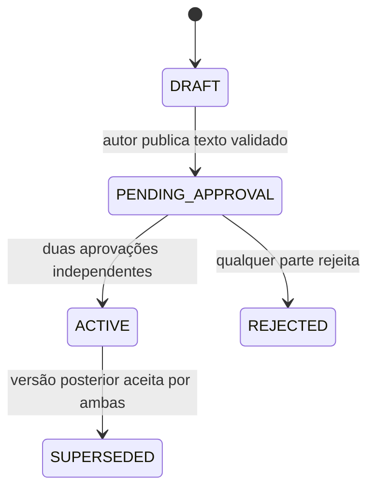

# ConecTA — RF13/RF14: aceitação bilateral e versões de acordos

**Base disponível nesta revisão:** matriz de requisitos e decisões previamente extraídas da monografia em conversa, mais os PRs #8–#11 e código dos repositórios. O DOCX original anexado expirou nesta sessão; os critérios textuais específicos devem ser reconferidos com a versão atual da monografia antes de afirmar conformidade académica.

## Intenção funcional

- RF13: formalizar condições da contratação com aceitação expressa por ambas as partes.
- RF14: permitir alterações negociadas, preservando as versões anteriores e o histórico de aprovações.
- RN02: trabalhador e empregador da contratação devem ser contas distintas.
- Dependência RN09/RF18: condições de pagamento incluem valor, método, momento/etapa e são associadas à versão aprovada.

## Estados e invariantes



1. **DRAFT:** autor prepara âmbito, entregáveis, critérios, valor, datas e plano de pagamentos. Pode guardar texto incompleto sem efeito contratual.
2. **PENDING_APPROVAL:** condições congeladas; ambas as partes reveem e aprovam a **mesma** versão; uma aprovação isolada não ativa nada.
3. **ACTIVE:** ambas as aprovações registadas com utilizador e data; atualiza os campos contratuais da demonstração.
4. **REJECTED:** a versão não produz efeitos; pode originar negociação posterior.
5. **SUPERSEDED:** versão antiga permanece consultável e imutável pelo fluxo normal, com histórico e valores originais.

Para alterações, a versão previamente ativa continua em vigor até à aprovação bilateral da proposta. Um contrato anterior sem registo versionado é identificado como **legado não validado**, sem aceitação retroativa inventada.

### Plano de pagamento

Cada condição contém identificador estável, etapa (adiantamento/marco/final), valor (MZN), método e momento/condição. A soma das parcelas deve corresponder ao orçamento. Registos externos posteriores incluem `agreementVersionId` e `agreementConditionId`, quando existe acordo ativo; um valor não pode exceder a condição aceite nem o total contratado.

O registo é declarativo. **A aplicação não guarda, transfere nem verifica fundos**; `CONFIRMED` representa a afirmação do trabalhador de ter recebido o montante, não confirmação bancária.

### Casos de validação automatizada

| Caso | Critério |
|---|---|
| A01 | Contrato novo gera v1 como DRAFT sem assinatura presumida |
| A02 | Publicação recusa texto incompleto e condições inconsistentes |
| A03 | Aprovação unilateral não ativa contrato; dupla aprovação ativa |
| A04 | Terceiros/administrador não aprovam em nome das partes |
| A05 | Versão publicada não pode ser editada por `saveDraft` |
| A06 | Proposta v2 não modifica valor/escopo/prazo da v1 ativa |
| A07 | Aprovação bilateral de v2 substitui v1, preservando o snapshot |
| A08 | Rejeição de v2 conserva v1; versão seguinte tem numeração monotónica |
| A09 | v1 rejeitada pode ser renegociada sem eliminar o histórico |
| A10 | Contratos legados não recebem aprovações inventadas |
| A11 | Pagamento externo ligado à etapa e versão aceites |
| A12 | Métodos e valores incompatíveis com a versão são rejeitados |
| A13 | Acordo novo não pode reduzir orçamento abaixo de pagamentos já declarados |
| A14 | Fluxos combinados RN01/RN02 + RF13/14 + pagamentos + conflitos permanecem testáveis |

### Execução esperada

```bash
npm ci
npm run lint
npm run build
npm test
```

A CI é uma condição técnica necessária, **não suficiente** para comprovar a validação experimental. Executar depois casos de uso no browser, recolher capturas, registrar ambiente, pré-condições, resultado observado e decisão Pass/Fail por requisito.

## Limitações e riscos para a monografia

- `localStorage` permite adulterar estados, valores e aprovações; não existe assinatura digital certificada, persistência inviolável ou controlo de acesso de servidor.
- Os módulos Django de contrato e assinatura estão vazios na versão observada. Não alegar implementação backend antes da integração e testes de API.
- Os termos são congelados pelas operações da aplicação, **não criptograficamente protegidos**.
- A sequência de escritas de `localStorage` não fornece transações ACID. É possível inconsistência em falhas de armazenamento.
- O contrato ainda apresenta `signedByEmployer`/`signedByWorker` para retrocompatibilidade. Na nova rotina estes campos só ficam verdadeiros após duas aprovações; o histórico verificável está nos eventos da versão.
- Não usar documentos reais de identificação, dados financeiros verdadeiros nem acordos juridicamente relevantes nesta demonstração.
- PR #11 continua como dependência. Integrar este PR **contra a branch de integração**, e não diretamente em `master`.
