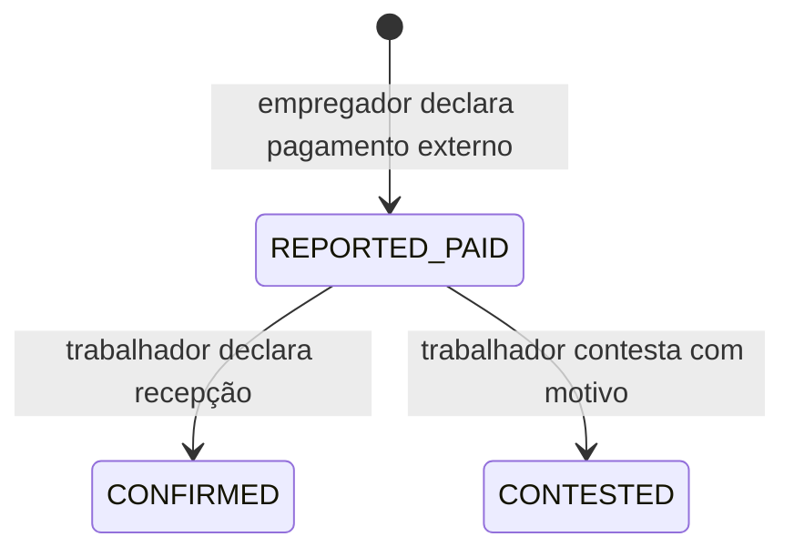

# ConecTA — Auditoria de pagamentos externos (RN09, RN10, RF18–RF20, V05)

**Documento-base:** Monografia_Chirley_112026(1).docx — versão de novembro de 2026.
**Componente:** frontend React de demonstração, com dados em `localStorage`.
**Estado:** implementado parcialmente; execução e validação ainda dependem dos resultados da CI e dos testes manuais.

## Regra e desenho

- **RN09:** cada condição de pagamento identifica valor, método, momento/etapa e estado.
- **RN10:** a plataforma não custodia fundos; eventuais transacções reais exigem prestador externo.
- **RF18:** condições de pagamento devem fazer parte do acordo contratual.
- **RF19:** a aplicação regista e acompanha estados; registo não comprova a liquidação.
- **RF20:** integração com prestador externo é opcional e não está implementada.
- **V05:** `REPORTED_PAID` é distinto de `CONFIRMED`, existe contestação e não há carteira/custódia.

### Estados declarativos



A confirmação indica uma **declaração da contraparte**, nunca confirmação independente da instituição financeira. A contestação não é resolvida automaticamente. O código conserva o histórico de transições (data, autor e observação) apenas no armazenamento local.

### Implementado nesta branch

- Elimina o endpoint fictício que marcava `completed` sem qualquer transacção.
- Apresenta fluxo separado para **concluir serviço** e **registar pagamento externo**.
- Valor, método, etapa, momento, data e referência fornecida pelo prestador (opcional).
- Valida que só o empregador do contrato pode declarar e só o trabalhador correspondente pode responder.
- Impede respostas repetidas e registo declarado acima do valor acordado.
- Conserva eventos com estado, autor, data e motivo.
- Isola pagamentos `completed` legados da antiga demo; nunca os transforma em `CONFIRMED`.
- Remove publicidade falsa de escrow, transferência efectiva, arbitragem jurídica e integração M-Pesa/e-Mola.

### Pendências honestas de conformidade

- **RF18/RN09 — parcial:** as condições ainda não estão vinculadas à **versão aceite do acordo**. Exige implementação de RF13/RF14 antes de classificar como completo.
- **RF19 — parcial:** a persistência é local e alterável pelo utilizador. Sem prova, autenticação e autorização no servidor.
- **RF20 — não implementado:** não existe PSP, webhook, verificação transacional, saldo nem custódia.
- **RN13 — pendente:** a administração de disputas contratuais fora do módulo de pagamentos ainda requer remediação; esta branch remove apenas as alegações públicas incorrectas.

## Cenários de validação

| ID | Cenário | Critério de aceitação |
|---|---|---|
| V05-01 | Empregador regista pagamento externo de adiantamento | Estado `REPORTED_PAID`; nenhum saldo creditado ou chamada PSP |
| V05-02 | Trabalhador confirma recepção | `CONFIRMED` com evento e autor; não é liquidação verificada |
| V05-03 | Trabalhador contesta | `CONTESTED` com justificação e histórico |
| V05-04 | Tentativa de autoconfirmação pelo empregador | Rejeitada |
| V05-05 | Utilizador alheio ao contrato tenta consultar/editar | Rejeitado no serviço simulado |
| V05-06 | Múltiplos pagamentos por etapas | Quantias acumuladas não excedem orçamento registado |
| V05-07 | Inserção de valores zero, negativos, excessivos ou data inválida | Rejeitada sem alterar registos |
| V05-08 | Pagamentos legados de `completed` da demonstração | Tratados como não verificados, nunca `CONFIRMED` |
| V05-09 | Concluir serviço sem registar pagamento | Estado do serviço muda; não cria registo de pagamento |
| V05-10 | Actualizar/recarregar a interface | Registos declarativos persistem apenas no mesmo navegador (limitação demonstrada) |

### Execução

```bash
npm ci
npm run lint
npm run build
npm test
```

### Padrão de evidência para a monografia

Para cada caso: ID, requisito, pré-condições, dados **sintéticos**, passos, resultado esperado, resultado observado, data/ambiente, screenshot ou log e classificação Pass/Fail/Blocked.

**Não declarar V05 validado apenas porque o código foi escrito ou a CI passou.** Exige execução funcional dos cenários e preservação das evidências.
